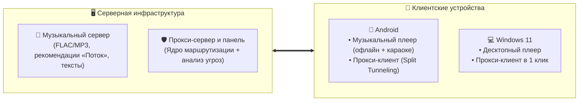

<div align="center">


# Sentinel Ecosystem

### Self-hosted музыкальный сервис и прокси-клиенты с анализом вредоносного трафика

[](LICENSE)
[](https://github.com/blackalex1)
[](#-компоненты)

<p align="center">
  Единая экосистема, объединяющая <b>персональный музыкальный стриминговый сервис</b> и <b>прокси-клиенты для обхода блокировок</b> со встроенным анализом вредоносного трафика.
</p>

[🎵 Музыка](#-1-музыкальный-сервис) • [🌐 Прокси-клиенты](#-2-прокси-клиенты-и-сетевая-безопасность) • [📦 Компоненты](#-компоненты) • [🚀 Быстрый запуск](#-быстрый-запуск)

---

</div>

## 📌 Обзор

Проект состоит из двух независимых направлений:
1. **Музыкальный стриминг**: хранение личной фонотеки, система рекомендаций («Поток»), синхронизированные караоке-тексты и клиенты для Android, ПК и браузера.
2. **Проксирование трафика**: прокси-клиенты для Windows и Android, веб-панель управления и специальное сетевое ядро, которое анализирует трафик и отсекает вредоносную активность.

---

## 🎵 1. Музыкальный сервис

Self-hosted сервис для потокового воспроизведения собственной музыки.

**Что есть:**
* **Серверная часть**: хранение треков, автоопределение обложек и метаданных, поддержка аудио без сжатия (FLAC) и MP3.
* **Система рекомендаций («Поток»)**: автоматический подбор похожих треков на основе векторной базы данных.
* **Караоке и тексты песен**: синхронизация слов с базой LRCLIB и посимвольная подсветка текста прямо во время воспроизведения.
* **Android-клиент**: нативный плеер на Jetpack Compose с сохранением музыки в память (офлайн-режим) и интеграцией в шторку/автомобиль.
* **Windows-клиент**: десктопный плеер на базе Tauri с поддержкой мультимедийных клавиш.
* **Веб-плеер**: встроенный веб-интерфейс для прослушивания музыки через любой браузер.

---

## 🌐 2. Прокси-клиенты и сетевая безопасность

Комплекс приложений для проксирования трафика, обхода сетевых ограничений и фильтрации угроз.

**Что есть:**
* **Анализ вредоносного трафика через ядро**: сетевое ядро анализирует соединения в реальном времени, отслеживает подозрительную активность и блокирует опасные ресурсы (фишинг, спам-боты, вредоносные домены).
* **Прокси-клиент для Windows 11**: десктопное приложение для подключения к серверам, управления профилями и маршрутизацией.
* **Прокси-клиент для Android**: мобильное приложение с поддержкой выборочного проксирования приложений (Split Tunneling) и режимом раздачи защищенного трафика (Hotspot Relay).
* **Панель управления**: веб-панель и Telegram-бот для генерации конфигураций, управления пользователями и лимитами трафика.
* **Защита и мониторинг хоста (Proxmox Sentinel)**: отдельный сервис активной защиты гипервизора Proxmox VE и серверов (IPS, блокировка несанкционированных процессов, аудит доступа), интегрированный с панелью управления.

---

## 🏛 Схема взаимодействия



---

## 📦 Компоненты

### 🎶 Музыка:
| Компонент | Назначение | Платформа | Ссылка |
| :--- | :--- | :--- | :--- |
| **Sentinel Music Server** | Сервер стриминга, векторный «Поток», база данных | Docker / Linux | [`sentinel-music-server`](https://github.com/blackalex1/sentinel-music-server) |
| **Sentinel Music Android** | Нативное мобильное приложение с караоке | Android | [`sentinel-music-android`](https://github.com/blackalex1/sentinel-music-android) |
| **Sentinel Music Desktop** | Десктопный плеер для компьютера | Windows | [`sentinel-music-desktop`](https://github.com/blackalex1/sentinel-music-desktop) |

### 🌐 Прокси и сетевая инфраструктура:
| Компонент | Назначение | Платформа | Ссылка |
| :--- | :--- | :--- | :--- |
| **Sentinel Desktop** | Прокси-клиент для Windows с анализом соединений | Windows 11 | [`sentinel-desktop`](https://github.com/blackalex1/sentinel-desktop) |
| **Sentinel Mobile** | Мобильный прокси-клиент с режимом Hotspot | Android | [`sentinel-mobile`](https://github.com/blackalex1/sentinel-mobile) |
| **Sentinel-Core** | Сетевое ядро: компиляция правил и анализ вредоносного трафика | Go / C-FFI | [`sentinel-core`](https://github.com/blackalex1/sentinel-core) |
| **Sentinel Control Panel** | Веб-панель и Telegram-бот для управления прокси | Docker / Web | [`sentinel-panel`](https://github.com/blackalex1/sentinel-panel) |
| **Proxmox Sentinel** | Сервис защиты гипервизора Proxmox VE и мониторинга (интегрирован с панелью) | Linux / Proxmox | [`proxmox_Sentinel`](https://github.com/blackalex1/proxmox_Sentinel) |

---

## 🚀 Быстрый запуск

### Музыкальный сервер
```bash
git clone https://github.com/blackalex1/sentinel-music-server.git
cd sentinel-music-server
python setup_env.py
docker compose up -d --build
```
Веб-интерфейс доступен по адресу `http://localhost:8000`.

### Прокси-сервер
```bash
bash <(curl -fsSL https://raw.githubusercontent.com/blackalex1/sentinel-panel/main/installation/install_with_docker.sh)
```
Скрипт разворачивает контейнеры и выводит реквизиты для входа в панель.

---

<div align="center">

Проект распространяется под лицензией [MIT](LICENSE).

</div>
