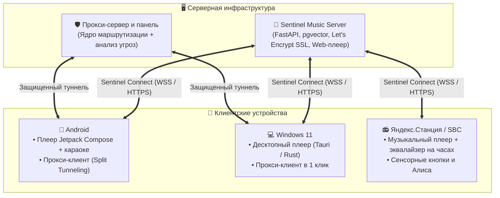

<div align="center">


# Sentinel Ecosystem

### Self-hosted музыкальный сервис и прокси-клиенты с анализом сетевых угроз

[](LICENSE)
[](https://github.com/blackalex1)
[](#-компоненты)

<p align="center">
  Единая экосистема, объединяющая <b>персональный музыкальный стриминговый сервис с клиентами для всех платформ (включая умные колонки)</b> и <b>прокси-инфраструктуру для обхода блокировок</b> со встроенным анализом вредоносного трафика.
</p>

[🎵 Музыка](#-1-музыкальный-сервис) • [📻 Умные колонки](#-умные-колонки-sentinel-station) • [🌐 Прокси-клиенты](#-2-прокси-клиенты-и-сетевая-безопасность) • [📦 Компоненты](#-компоненты) • [🚀 Быстрый запуск](#-быстрый-запуск)

---

</div>

## 📌 Обзор

Экосистема Sentinel объединяет два ключевых направления:
1. **Музыкальный стриминг и Sentinel Connect**: персональный медиасервер с векторными рекомендациями («Поток»), синхронизированными караоке-текстами (LRCLIB), нативными приложениями для Android и Windows, веб-плеером и автономным демоном для умных колонок Яндекс.Станция.
2. **Проксирование и сетевая безопасность**: экосистема для обхода сетевых ограничений и фильтрации сетевых атак, включающая клиенты для Windows и Android, веб-панель управления, Telegram-бота и защитный сервис для гипервизоров Proxmox VE.

---

## 🎵 1. Музыкальный сервис

Self-hosted сервис для потокового воспроизведения и управления персональной фонотекой высокой четкости.

### Ключевые возможности:
* **Серверная часть (FastAPI + pgvector)**: хранение и стриминг FLAC и MP3 без потери качества (HTTP 206 Range), автоопределение обложек и тегов, встроенная автоматическая выдача SSL-сертификатов Let's Encrypt (ACME HTTP-01).
* **Система рекомендаций («Поток»)**: векторная модель на базе PostgreSQL + pgvector, анализирующая акустические свойства треков и предпочтения пользователя для генерации бесконечного персонального радио.
* **Караоке и синхронизация текстов**: интеграция с базой LRCLIB, сохранение текстов и посимвольная миллисекундная подсветка слов при воспроизведении.
* **Sentinel Connect**: защищенный протокол удаленного управления (WSS/HTTPS) в реальном времени. Позволяет переключать треки, изменять громкость и управлять очередью между телефоном, компьютером, веб-браузером и умной колонкой.
* **Android-клиент**: нативное приложение на **Jetpack Compose + AndroidX Media3 (ExoPlayer)** с фоновым воспроизведением, кэшированием в память для офлайн-режима, поддержкой Android Auto и системных уведомлений.
* **Windows-клиент**: десктопное приложение на базе **Tauri (Rust)** и WebView2 с низким потреблением памяти (~30-50 МБ) и поддержкой мультимедийных клавиш.
* **Веб-плеер**: адаптивный интерфейс для браузера с поддержкой адаптивных обложек и караоке.

---

## 📻 Умные колонки (Sentinel Station)

Превращает Яндекс.Станцию (Мини, Лайт, Станцию 2) и мини-компьютеры Raspberry Pi в полноценный независимый плеер для вашей домашней музыки.

* **Чистый звук без потерь**: воспроизведение любимых треков в высоком качестве (FLAC и MP3) как через встроенный динамик Станции, так и на больших внешних колонках по кабелю (AUX).
* **Живой экран-эквалайзер**: встроенные часы на корпусе превращаются в эквалайзер, танцующий в такт музыке, показывают время, прогресс песни и плавные анимации при смене трека.
* **Умная подсветка**: светящееся кольцо на колонке красиво переливается и наглядно отображает уровень громкости.
* **Сенсорные кнопки на корпусе**: касания по кнопкам паузы и громкости управляют именно вашей музыкой, не вызывая лишний раз Алису.
* **Голосовое управление**: скажите привычное *«Алиса, включи поток»*, и колонка сразу начнет играть вашу персональную волну музыки с сервера.
* **Управление с любого устройства (Sentinel Connect)**: переключайте треки на колонке прямо со смартфона, ноутбука или через веб-браузер в один клик.

---

## 🌐 2. Прокси-клиенты и сетевая безопасность

Комплекс приложений для маршрутизации трафика, обхода сетевых ограничений и фильтрации угроз.

* **Анализ вредоносного трафика через сетевое ядро (Sentinel-Core)**: ядро анализирует пакеты в реальном времени, отсекая фишинг, спам-боты и вредоносные узлы.
* **Клиент для Windows 11**: десктопное приложение для подключения к серверам, управления профилями и маршрутизацией.
* **Клиент для Android**: мобильный клиент с поддержкой выборочного проксирования (Split Tunneling) и режима Hotspot Relay.
* **Панель управления**: веб-интерфейс и Telegram-бот для генерации профилей, управления пользователями и лимитами.
* **Proxmox Sentinel**: модуль активной защиты хоста гипервизора Proxmox VE (IPS, аудит доступа, защита от несанкционированных процессов).

---

## 🏛 Схема архитектуры



---

## 📦 Компоненты

### 🎶 Музыкальная экосистема:
| Компонент | Назначение | Стек / Платформа | Ссылка |
| :--- | :--- | :--- | :--- |
| **Sentinel Music Server** | Сервер стриминга, векторный «Поток», SSL, база данных | FastAPI, Docker, pgvector | [`sentinel-music-server`](https://github.com/blackalex1/sentinel-music-server) |
| **Sentinel Music Android** | Нативное мобильное приложение с караоке и офлайн-режимом | Kotlin, Jetpack Compose, Media3 | [`sentinel-music-android`](https://github.com/blackalex1/sentinel-music-android) |
| **Sentinel Music Desktop** | Легковесный десктопный плеер для компьютера | Tauri 2.0, Rust, WebView2 | [`sentinel-music-desktop`](https://github.com/blackalex1/sentinel-music-desktop) |
| **Sentinel Station** | Музыкальный плеер для умных колонок Яндекс.Станция с экраном и Алисой | Linux / ARM | [`sentinel-music-station`](https://github.com/blackalex1/sentinel-music-station) |

### 🌐 Прокси и сетевая инфраструктура:
| Компонент | Назначение | Стек / Платформа | Ссылка |
| :--- | :--- | :--- | :--- |
| **Sentinel Desktop** | Прокси-клиент для Windows с анализом соединений | Windows 11 | [`sentinel-desktop`](https://github.com/blackalex1/sentinel-desktop) |
| **Sentinel Mobile** | Мобильный прокси-клиент с режимом Hotspot | Android | [`sentinel-mobile`](https://github.com/blackalex1/sentinel-mobile) |
| **Sentinel-Core** | Сетевое ядро: компиляция правил и анализ вредоносного трафика | Go / C-FFI | [`sentinel-core`](https://github.com/blackalex1/sentinel-core) |
| **Sentinel Control Panel** | Веб-панель и Telegram-бот для управления прокси | Docker / Web | [`sentinel-panel`](https://github.com/blackalex1/sentinel-panel) |
| **Proxmox Sentinel** | Модуль защиты гипервизора Proxmox VE и мониторинга | Linux / Proxmox | [`proxmox_Sentinel`](https://github.com/blackalex1/proxmox_Sentinel) |

---

## 🚀 Быстрый запуск

### Музыкальный сервер
```bash
git clone https://github.com/blackalex1/sentinel-music-server.git
cd sentinel-music-server
python setup_env.py
docker compose up -d --build
```
Веб-интерфейс доступен по адресу `http://localhost:8000` (или `https://ваш-домен:8000` после настройки SSL).

### Яндекс.Станция (Sentinel Station)
Подключитесь к рутованной колонке по SSH и выполните скрипт установки:
```bash
wget -O- https://raw.githubusercontent.com/blackalex1/sentinel-music-station/main/scripts/install.sh | sh
```
Отредактируйте `/data/opt/sentinel-station/config.toml` (укажите адрес сервера и токен) и перезапустите службу:
```bash
/etc/init.d/S99sentinel-station restart
```

### Прокси-сервер
```bash
bash <(curl -fsSL https://raw.githubusercontent.com/blackalex1/sentinel-panel/main/installation/install_with_docker.sh)
```
Скрипт разворачивает контейнеры и выводит реквизиты для входа в панель.

---

<div align="center">

Все компоненты экосистемы распространяются под лицензией [MIT](LICENSE).

</div>
