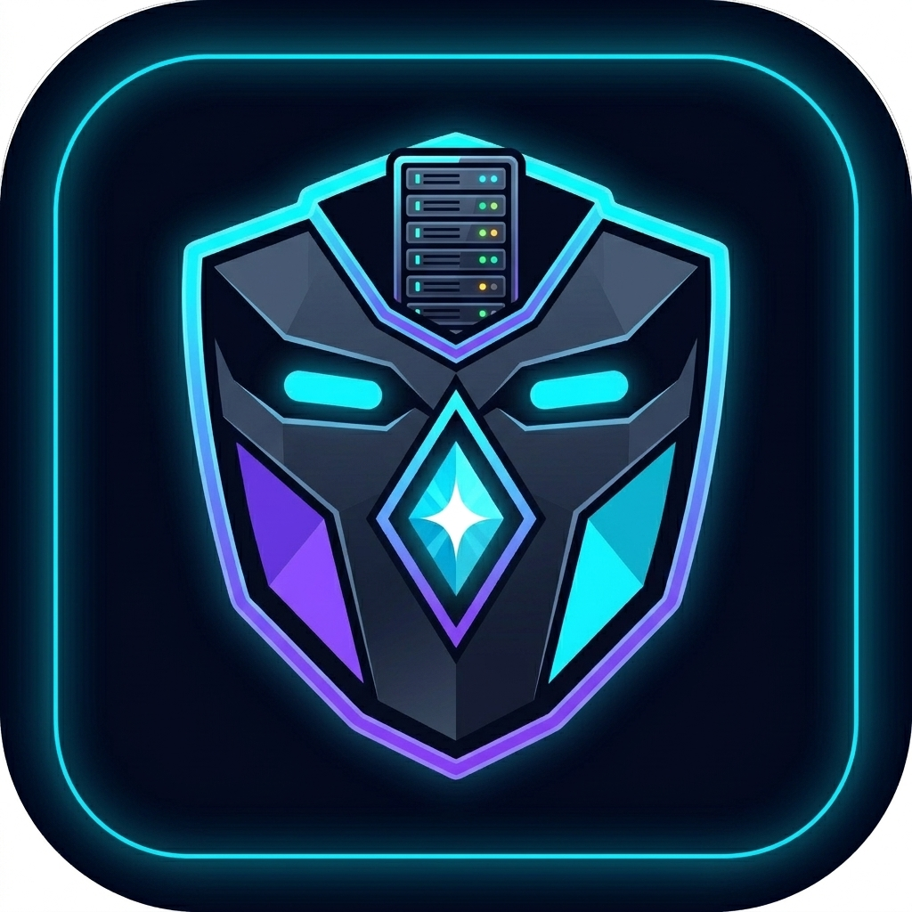
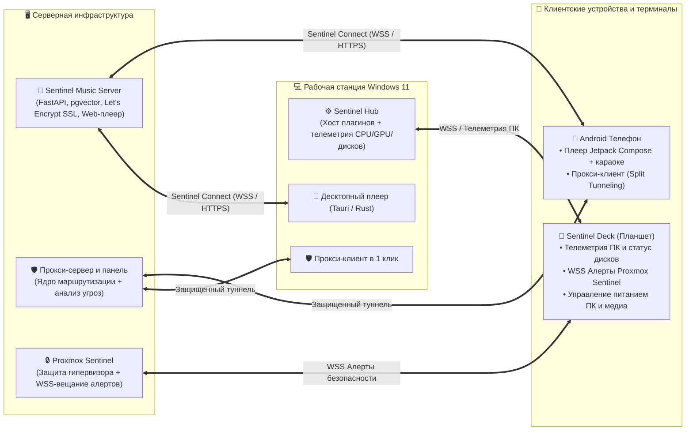

<div align="center">



# Sentinel Ecosystem

### Self-hosted музыкальный сервис, прокси-клиенты и планшетная дашборд-панель с телеметрией

[](LICENSE)
[](https://github.com/blackalex1)
[](#-компоненты)

<p align="center">
  Единая экосистема, объединяющая <b>персональный музыкальный стриминговый сервис</b>, <b>прокси-инфраструктуру для обхода блокировок</b> со встроенным анализом сетевых угроз и <b>планшетную дашборд-панель управления рабочим местом</b>.
</p>

[🎵 Музыка](#-1-музыкальный-сервис) • [🌐 Прокси-клиенты](#-2-прокси-клиенты-и-сетевая-безопасность) • [🖥️ Дашборд и телеметрия](#-3-мониторинг-телеметрия-и-дашборд-панель-deck--hub) • [📦 Компоненты](#-компоненты) • [🚀 Быстрый запуск](#-быстрый-запуск)

---

</div>

## 📌 Обзор

Экосистема Sentinel объединяет три ключевых направления:
1. **Музыкальный стриминг и Sentinel Connect**: персональный медиасервер с векторными рекомендациями («Поток»), синхронизированными караоке-текстами (LRCLIB), нативными приложениями для Android и Windows, веб-плеером и протоколом синхронизации воспроизведения в реальном времени.
2. **Проксирование и сетевая безопасность**: экосистема для обхода сетевых ограничений и фильтрации сетевых атак, включающая клиенты для Windows и Android, веб-панель управления, Telegram-бота и защитный сервис для гипервизоров Proxmox VE.
3. **Мониторинг, телеметрия и дашборд-панель (Deck & Hub)**: планшетный терминал Sentinel Deck (Android / Jetpack Compose) для управления ПК, отслеживания телеметрии оборудования (CPU, GPU, RAM, диски), прямого WSS-мониторинга угроз Proxmox Sentinel, управления мультимедиа и фоновый сервис-хост Sentinel Hub для Windows.

---

## 🎵 1. Музыкальный сервис

Self-hosted сервис для потокового воспроизведения и управления персональной фонотекой высокой четкости.

### Ключевые возможности:
* **Серверная часть (FastAPI + pgvector)**: хранение и стриминг FLAC и MP3 без потери качества (HTTP 206 Range), автоопределение обложек и тегов, встроенная автоматическая выдача SSL-сертификатов Let's Encrypt (ACME HTTP-01).
* **Система рекомендаций («Поток»)**: векторная модель на базе PostgreSQL + pgvector, анализирующая акустические свойства треков и предпочтения пользователя для генерации бесконечного персонального радио.
* **Караоке и синхронизация текстов**: интеграция с базой LRCLIB, сохранение текстов и посимвольная миллисекундная подсветка слов при воспроизведении.
* **Sentinel Connect**: защищенный протокол удаленного управления (WSS/HTTPS) в реальном времени. Позволяет переключать треки, изменять громкость и управлять очередью между телефоном, компьютером и веб-браузером.
* **Android-клиент**: нативное приложение на **Jetpack Compose + AndroidX Media3 (ExoPlayer)** с фоновым воспроизведением, кэшированием в память для офлайн-режима, поддержкой Android Auto и системных уведомлений.
* **Windows-клиент**: десктопное приложение на базе **Tauri (Rust)** и WebView2 с низким потреблением памяти (~30-50 МБ) и поддержкой мультимедийных клавиш.
* **Веб-плеер**: адаптивный интерфейс для браузера с поддержкой адаптивных обложек и караоке.

---

## 🌐 2. Прокси-клиенты и сетевая безопасность

Комплекс приложений для безопасного туннелирования трафика, обхода блокировок и фильтрации сетевых угроз.

### Ключевые возможности:
* **Анализ сетевых угроз через ядро Sentinel-Core**: потоковый анализ открытых сетевых соединений на устройствах, выявление признаков вредоносной активности (ботнеты, майнеры, сканирование портов) и блокировка опасных ресурсов на лету.
* **Windows-клиент (Sentinel Desktop)**: десктопное приложение для Windows 11 с подключением в один клик, интерактивной картой узлов, статистикой трафика и мониторингом сетевых интерфейсов.
* **Android-клиент (Sentinel Mobile)**: мобильное приложение с поддержкой раздельного туннелирования (Split Tunneling по приложениям), интеграцией с системным VPN API и режимом Hotspot Relay (раздача защищенного интернета).
* **Sentinel Control Panel**: единая веб-панель управления и Telegram-бот (Mini App) для выпуска конфигураций, настройки правил маршрутизации и мониторинга нод.
* **Proxmox Sentinel**: модуль активной безопасности гипервизора Proxmox VE (IPS, защита от брутфорса SSH, аудит процессов) с прямой передачей алертов в мобильный дашборд Sentinel Deck.

---

## 🖥️ 3. Мониторинг, телеметрия и дашборд-панель (Deck & Hub)

Комплекс приложений для превращения планшета на Android в сенсорную панель мониторинга и управления рабочим местом (Stream Deck / Smart Display).

### Ключевые возможности:
* **Sentinel Deck (Android)**: нативное приложение на Jetpack Compose с кастомизируемой сеткой виджетов (графики температур и нагрузки CPU/GPU/RAM, статус дисков, кнопки управления питанием ПК, быстрый запуск софта, плеер Sentinel Music с караоке, прямое защищенное WSS-подключение к Proxmox Sentinel с парсингом Markdown алертов и свайп-удалением).
* **Sentinel Hub (Windows)**: легковесный локальный фоновый сервис (хост плагинов), собирающий аппаратную телеметрию ПК, предоставляющий WebSocket API и мост к сервисам экосистемы (Sentinel Music, Proxmox, Keenetic).

---

## 🏛 Схема взаимодействия



---

## 📦 Компоненты

### 🎶 Музыкальная экосистема:
| Компонент | Назначение | Стек / Платформа | Ссылка |
| :--- | :--- | :--- | :--- |
| **Sentinel Music Server** | Сервер стриминга, векторный «Поток», SSL, база данных | FastAPI, Docker, pgvector | [`sentinel-music-server`](https://github.com/blackalex1/sentinel-music-server) |
| **Sentinel Music Android** | Нативное мобильное приложение с караоке и офлайн-режимом | Kotlin, Jetpack Compose, Media3 | [`sentinel-music-android`](https://github.com/blackalex1/sentinel-music-android) |
| **Sentinel Music Desktop** | Легковесный десктопный плеер для компьютера | Tauri 2.0, Rust, WebView2 | [`sentinel-music-desktop`](https://github.com/blackalex1/sentinel-music-desktop) |

### 🌐 Прокси и сетевая инфраструктура:
| Компонент | Назначение | Стек / Платформа | Ссылка |
| :--- | :--- | :--- | :--- |
| **Sentinel Desktop** | Прокси-клиент для Windows с анализом соединений | Windows 11 | [`sentinel-desktop`](https://github.com/blackalex1/sentinel-desktop) |
| **Sentinel Mobile** | Мобильный прокси-клиент с режимом Hotspot | Android | [`sentinel-mobile`](https://github.com/blackalex1/sentinel-mobile) |
| **Sentinel-Core** | Сетевое ядро: компиляция правил и анализ вредоносного трафика | Go / C-FFI | [`sentinel-core`](https://github.com/blackalex1/sentinel-core) |
| **Sentinel Control Panel** | Веб-панель и Telegram-бот для управления прокси | Docker / Web | [`sentinel-panel`](https://github.com/blackalex1/sentinel-panel) |
| **Proxmox Sentinel** | Модуль защиты гипервизора Proxmox VE и мониторинга | Linux / Proxmox | [`proxmox_Sentinel`](https://github.com/blackalex1/proxmox_Sentinel) |

### 🖥️ Мониторинг, телеметрия и дашборд-панель (Smart Hub & Deck):
| Компонент | Назначение | Стек / Платформа | Ссылка |
| :--- | :--- | :--- | :--- |
| **Sentinel Deck** | Планшетная панель управления (Stream Deck / Dashboard) для мониторинга ПК, Proxmox, медиа и виджетов | Android (Jetpack Compose) | [`sentinel-deck`](https://github.com/blackalex1/sentinel-deck) |
| **Sentinel Hub** | Локальный сервис телеметрии ПК, хост плагинов и мост интеграций для экосистемы | Windows 11 / Python | [`sentinel-hub`](https://github.com/blackalex1/sentinel-hub) |

---

## 🚀 Быстрый запуск

### Музыкальный сервер
```bash
git clone https://github.com/blackalex1/sentinel-music-server.git
cd sentinel-music-server
python setup_env.py
docker compose up -d --build
```
Веб-интерфейс доступен по адресу `http://localhost:8000` (или `https://ваш-домен:8000` после настройки SSL).

### Прокси-сервер
```bash
bash <(curl -fsSL https://raw.githubusercontent.com/blackalex1/sentinel-panel/main/installation/install_with_docker.sh)
```
Скрипт разворачивает контейнеры и выводит реквизиты для входа в панель.

---

<div align="center">

Все компоненты экосистемы распространяются под лицензией [MIT](LICENSE).

</div>
